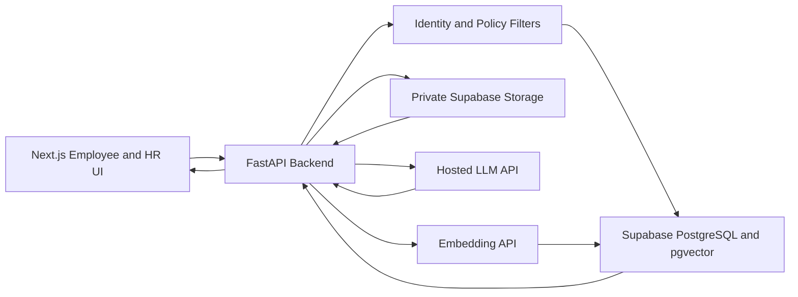

# PeoplePolicy AI

> **HR policy answers, grounded in the right document for each employee.**

PeoplePolicy AI is an AI-powered HR policy assistant designed to help employees find clear answers to policy questions and help HR teams manage policy documents more efficiently. It uses retrieval-augmented generation (RAG) to ground responses in relevant policy passages, with verifiable source references and region- and employment-aware retrieval.

**MVP focus:** Multi-region policy support · PDF policies · RAG · Verified citations

---

## Table of Contents

- [Overview](#overview)
- [Problem Statement](#problem-statement)
- [Goals](#goals)
- [Core Features](#core-features)
- [How It Works](#how-it-works)
- [Architecture](#architecture)
- [Recommended Tech Stack](#recommended-tech-stack)
- [Core Data Model](#core-data-model)
- [API Surface](#api-surface)
- [Security, Trust, and Safety](#security-trust-and-safety)
- [MVP Scope](#mvp-scope)
- [Implementation Roadmap](#implementation-roadmap)
- [Evaluation Targets](#evaluation-targets)
- [Getting Started](#getting-started)
- [Project Status](#project-status)
- [Disclaimer](#disclaimer)

## Overview

Employees often need to search through policy documents or contact HR to understand leave, benefits, eligibility wording, and workplace processes. HR teams, meanwhile, spend time answering repeated questions and locating the latest applicable policy.

PeoplePolicy AI aims to provide a simple experience: employees ask questions in natural language and receive answers based on policies that apply to their region and employment context. Answers should link to the underlying policy evidence so employees can verify the information themselves.

The assistant explains policy information; it does **not** make binding HR or legal decisions.

## Problem Statement

### For employees
- Policy information can be difficult to locate.
- The applicable rule may differ by region or employment type.
- Employees need to understand where an answer came from.

### For HR teams
- Repeated questions consume time.
- Policy documents may be scattered across locations or versions.
- Unanswered questions and conflicting policies can be hard to identify.

## Goals

- Make applicable HR policy information easier to find.
- Ground answers in retrieved policy evidence.
- Provide citations that link to actual source records.
- Respect employee role, region, employment context, publication status, and effective dates.
- Ask for clarification or abstain when the evidence is insufficient.
- Give HR a workflow to review, publish, version, and archive policy PDFs.
- Surface unanswered questions and feedback as signals for improving policy coverage.

## Core Features

### Employee experience
- Natural-language questions about leave, benefits, eligibility, and policy processes.
- Region- and employment-aware policy retrieval.
- Answers with source policy, version, section, and page references where available.
- Clarification when required context is missing.
- Safe fallback when the documents do not support an answer.
- Feedback on responses and access to source material.

### HR administration
- Upload and validate policy PDFs.
- Extract text while preserving page references.
- Chunk and index policy passages for retrieval.
- Review policy metadata and applicability before publication.
- Manage policy versions and lifecycle states.
- Publish and archive policies.
- View common topics, low-confidence or unanswered questions, feedback, and knowledge gaps.

### Evidence-first retrieval
- Retrieve only policies within the employee's permitted scope.
- Prioritize published policies that are effective for the relevant dates.
- Exclude archived policies from normal retrieval.
- Detect conflicting policy evidence and route it to HR rather than silently choosing a rule.
- Attach citations from real retrieved source records—not citations invented by the language model.

## How It Works

### 1. Add a policy

1. HR uploads a PDF.
2. The system validates the file.
3. Text is extracted with page references.
4. Text is divided into passages (chunks) and associated with metadata.
5. Embeddings are generated and indexed.
6. HR reviews the policy scope and applicability.
7. HR publishes the policy, making it available for eligible retrieval.

Each policy should include its title, policy code, version, storage path, explicit region, employment type, effective dates, and lifecycle state. A filename alone must never determine policy applicability.

**Policy lifecycle:** `Draft → Processing → Review → Published → Archived`

### 2. Answer an employee question

1. Authenticate the employee and resolve their context.
2. Apply role, region, employment, date, and publication-status filters.
3. Retrieve relevant policy passages.
4. Check evidence strength and identify conflicts.
5. Generate an answer or choose a safe fallback.
6. Attach source links that resolve to the actual retrieved passages.

Possible response states:

| State | Meaning |
|---|---|
| `ANSWERED` | The available evidence supports a response. |
| `NEEDS_CLARIFICATION` | A required detail is missing. |
| `INSUFFICIENT_EVIDENCE` | The available documents do not support a safe answer. |
| `POLICY_CONFLICT` | Relevant sources disagree and HR review is needed. |

## Architecture

The planned system consists of a web application, a policy-aware API, private document storage, a PostgreSQL retrieval layer, and hosted AI APIs.

### Architecture responsibilities

| Component | Responsibility |
|---|---|
| Next.js frontend | Employee chat, source viewer, HR administration, and analytics UI |
| FastAPI backend | Authentication integration, policy rules, retrieval orchestration, and API endpoints |
| Supabase PostgreSQL | Profiles, policy metadata, conversations, feedback, audit events, and related records |
| pgvector | Store and search policy embeddings |
| Supabase private Storage | Store policy PDF files privately |
| Hosted LLM API | Generate responses grounded in retrieved evidence |
| Embedding API | Convert policy passages and queries into embeddings |

### Security boundary

The backend enforces identity, role, region, publication status, and effective-date constraints **before** policy content is sent to the model. The language model must not decide access permissions.

## Recommended Tech Stack

| Layer | Technology |
|---|---|
| Frontend | Next.js, TypeScript, Tailwind CSS |
| Backend | Python, FastAPI |
| Database | Supabase PostgreSQL |
| Vector search | pgvector |
| File storage | Private Supabase Storage |
| AI | Hosted LLM API and embedding API |
| Frontend deployment | Vercel |
| Backend deployment | Managed Python hosting |

These are the technologies recommended by the PRD. The final provider configuration and environment variables should be documented as implementation decisions are made.

## Core Data Model

The MVP is intended to keep the data model small while preserving policy scope, source provenance, and auditability.

| Entity | Purpose |
|---|---|
| Profiles and regions | Employee role, region, and employment context |
| Policies and scopes | Policy version, lifecycle state, applicability, effective dates, and storage path |
| Policy chunks | Extracted text, page number, section title, and embedding vector |
| Conversations and sources | Questions, answers, and source chunks used for each answer |
| Feedback and audit events | Quality signals and traceable administrative changes |

## API Surface

The PRD identifies the following API groups. Exact endpoint contracts should be defined during implementation.

### Employee APIs
- `/me` — employee context
- `/chat` — ask policy questions
- Conversations — conversation history and related source references
- Message feedback — collect feedback on answers
- Source viewer — access permitted policy evidence

### HR admin APIs
- Policy upload and processing
- Policy publication
- Policy archiving
- Analytics
- Knowledge-gap reporting

## Security, Trust, and Safety

Trust is a core product requirement.

- **Access control:** Verify identity and role on every protected endpoint.
- **Scope filtering:** Apply policy applicability filters before retrieval.
- **Private data:** Keep policy PDFs in private storage and secrets on the server.
- **Auditability:** Record sensitive administrative changes.
- **Prompt-injection resistance:** Treat PDF text as untrusted data; never follow instructions embedded in policy documents.
- **Conflict handling:** Surface disagreements between current policies for HR review.
- **Honest uncertainty:** Ask for missing context or abstain when evidence is weak.
- **Verifiable citations:** Link to actual retrieved chunk records.
- **No unauthorized reads:** Test that employees cannot retrieve policy content outside their permitted scope.

## MVP Scope

### Included in the MVP
- Multi-region policy support.
- PDF policy ingestion.
- Page-aware text extraction and chunking.
- Embedding-based retrieval.
- Region- and employment-aware filtering.
- Grounded answers with source references.
- Clarification, abstention, and policy-conflict handling.
- HR review, publication, versioning, and archiving.
- Feedback and basic knowledge-gap insights.

### Explicitly out of scope
- Leave approvals.
- Payroll calculations.
- Binding legal or entitlement decisions.
- HRIS integrations.
- OCR for scanned PDFs.
- Automatic policy authoring.

## Implementation Roadmap

The PRD recommends proving the complete evidence loop before adding polish.

| Phase | Focus | Key work |
|---|---|---|
| 1. Foundation | Application foundation | Repository, authentication, migrations, private storage, health checks |
| 2. Ingestion | Policy processing | PDF validation, page-aware extraction, chunking, embeddings |
| 3. Regional retrieval | Applicability | Explicit scopes, effective dates, published-policy filters |
| 4. Grounded Q&A | Reliable answers | Citations, clarification, abstention, conflict handling |
| 5. Product UI | Employee and HR workflows | Chat, source viewer, policy lifecycle, feedback |
| 6. Quality and launch | Verification | Regression evaluation, security checks, deployment, demo |

### First vertical slice

> Upload one policy PDF → extract page-level text → index it → ask one question → retrieve evidence → return an answer with a working source link.

### Definition of done

The core MVP is complete when a user can sign in and receive a region-appropriate answer with verifiable sources—or a safe fallback—and HR can publish and archive policies without exposing unauthorized content.

## Evaluation Targets

The PRD proposes the following initial targets. **These are targets, not achieved results**, and must be measured against a reviewed evaluation set.

| Metric | Proposed target |
|---|---:|
| Correctness on reviewed, supported questions | ≥ 90% |
| Citations resolving to real sources | 100% |
| Critical regional tests passed | 100% |
| Unauthorized reads | 0 |

The evaluation set should include regional edge cases, missing-context questions, unsupported questions, conflicting policies, citation resolution, and access-control checks.

## Getting Started

This repository's exact setup commands depend on the implementation and the environment configuration. The following is the intended setup outline, not a claim that the application is already runnable.

### Prerequisites

- Node.js and a package manager compatible with the frontend lockfile.
- Python and `pip` for the FastAPI backend.
- A Supabase project with PostgreSQL, pgvector, and private Storage configured.
- Credentials for a hosted LLM and embedding provider.

### Setup outline

1. Clone the repository.
2. Install frontend dependencies using the package manager indicated by the frontend lockfile.
3. Create and activate a Python virtual environment for the backend.
4. Install backend dependencies from the project's dependency file.
5. Configure environment variables for Supabase and the AI providers. Keep secrets server-side and do not commit `.env` files.
6. Apply database migrations and enable the required vector-search support.
7. Start the backend and frontend using the scripts documented in their respective directories.

> **Note:** Add exact install, migration, test, and run commands here once the repository structure and scripts are finalized. Do not put real API keys or credentials in this README.

## Project Status

PeoplePolicy AI is specified by a Product Requirements Document (PRD), Version 1.0. This README describes the planned MVP and recommended architecture; it does not imply that all listed features are implemented or production-ready.

Implementation progress, known limitations, and verified deployment links should be updated here as the project develops.

## Disclaimer

PeoplePolicy AI is intended to explain HR policies using available source documents. It is not a substitute for HR review, professional legal advice, or formal approval of employment decisions. When evidence is insufficient or policies conflict, the system should communicate uncertainty and direct the question to HR.
