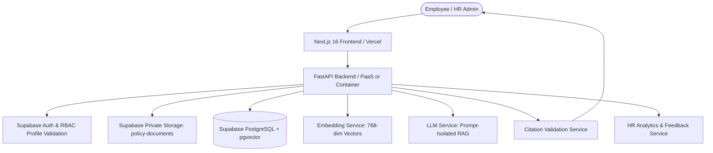
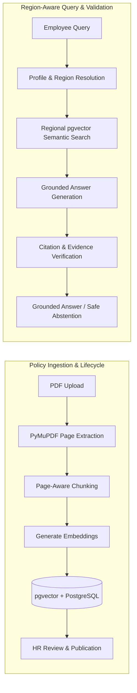

# PolicyPilot AI
### Enterprise AI-Powered, Region-Aware HR Policy Assistant

PolicyPilot AI is a trustworthy HR policy assistant that enables employees to obtain accurate, context-aware answers to workplace policy questions with verifiable citations, regional boundaries, and automated policy lifecycle management.

Unlike generic chatbots, PolicyPilot grounds answers strictly in approved company policies, filters retrieval by regional eligibility, cites exact source pages, and abstains when evidence is insufficient or conflicting.

---

## 🏗️ System Architecture



---

## 🔄 Technical Workflow



---

## 🛠️ Technology Stack

| Component | Technology | Description |
|---|---|---|
| **Frontend** | Next.js 16 (App Router), TypeScript, React 19 | Enterprise dashboard with authenticated route guards |
| **Backend** | Python 3.11+, FastAPI, Uvicorn | High-performance asynchronous REST API |
| **Database** | Supabase PostgreSQL + pgvector | Relational schema with HNSW/cosine vector indexing |
| **Migrations** | Alembic (asyncpg) | Version-controlled schema migrations |
| **Document Storage**| Supabase Private Storage | Secured PDF document storage with signed URLs |
| **PDF Processing** | PyMuPDF (fitz) | High-fidelity page-aware text and metadata extraction |
| **AI / Embeddings** | Ollama / OpenAI-compatible APIs | 768-dim embeddings (`nomic-embed-text`) & LLM generation |
| **Quality & Tests** | Pytest, Node Test Runner, ESLint, TypeScript | 163 backend tests, 20 frontend test suites |

---

## 🔐 Security & Access Control

- **Role-Based Access Control (RBAC):** Server-side verification of `EMPLOYEE` vs `HR_ADMINISTRATOR`. Client claims are ignored.
- **Geographic Data Boundaries:** Queries and policy access enforce strict regional boundaries (`US`, `EU`, `APAC`, `LATAM`, and `GLOBAL`).
- **Storage Authorization Guards:** Policy PDFs cannot be downloaded unless the user is an HR admin or the document is `PUBLISHED` and within their region.
- **Input Validation & DoS Protection:** Chat messages enforce `max_length=2000` to prevent token amplification and memory exhaustion.
- **Prompt Injection Hardening:** User questions are structurally isolated using `<user_question>` delimiters with strict system prompt grounding constraints.

---

## 💻 Local Development Setup

### 1. Prerequisites
- Python 3.11+
- Node.js 18+ (Node 24 LTS supported)
- Git

### 2. Quick Setup

```bash
# Clone the repository
git clone https://github.com/nidhi041/PolicyPilot.git
cd PolicyPilot

# 1. Backend setup
cd backend
python -m venv .venv
.\.venv\Scripts\activate   # Linux/macOS: source .venv/bin/activate
pip install -r requirements.txt
cp .env.example .env       # Configure DATABASE_URL and Supabase credentials
cd ..

# 2. Frontend setup
cd frontend
npm install --prefer-offline
cp .env.local.example .env.local
cd ..
```

### 3. Database Migrations
Apply database schema and vector extensions via Alembic:
```bash
cd backend
alembic upgrade head
cd ..
```

### 4. Running Development Servers
From the root repository directory:
```bash
# Run both frontend (http://localhost:3000) and backend (http://localhost:8000)
npm run dev:frontend
npm run dev:backend
```

---

## 🧪 Running Tests & Quality Checks

Run the complete verification suite from the root directory:
```bash
# Full test suite (Frontend TypeScript, ESLint, Unit Tests + Backend Pytest)
npm test

# Service-specific test suites
npm run test:frontend
npm run test:backend

# Production frontend build validation
npm run build:frontend
```

---

## 🚀 Production Deployment

PolicyPilot is prepared for cloud deployment:
- **Frontend**: Hosted on [Vercel](https://vercel.com) using [`frontend/vercel.json`](frontend/vercel.json).
- **Backend**: Container or PaaS hosting using [`backend/Procfile`](backend/Procfile) or [`backend/Dockerfile`](backend/Dockerfile).
- **Health Checks**: `/health` endpoint returns HTTP 200 for healthy instances and HTTP 503 for degraded database connectivity.
- **Deployment Guide**: See [DEPLOYMENT.md](DEPLOYMENT.md) for full deployment instructions and environment configuration.

---

## ⚠️ Known Limitations & Operational Considerations

1. **Embedding Dimension Matching:** The vector table schema uses 768 dimensions. If switching to 1536-dim models (e.g. OpenAI `text-embedding-3-small`), run a migration to update column dimensions.
2. **LLM Non-Determinism:** While the citation validation engine rejects ungrounded claims, slight variations in phrasing may occur across different model backends.
3. **Supabase Service Role Access:** The backend uses the Supabase Service Role key for administrative operations; access controls and regional boundaries are strictly enforced at the FastAPI boundary.

---

## 📋 Release Checklist

- [x] All 163 backend tests passing (`pytest backend/tests`).
- [x] All 20 frontend unit & lint checks passing (`npm test --prefix frontend`).
- [x] Production build validated with 0 errors (`npm run build --prefix frontend`).
- [x] Security audit and hardening verified (input limits, storage guards, prompt isolation).
- [x] Database migrations documented and tested against Supabase PostgreSQL.