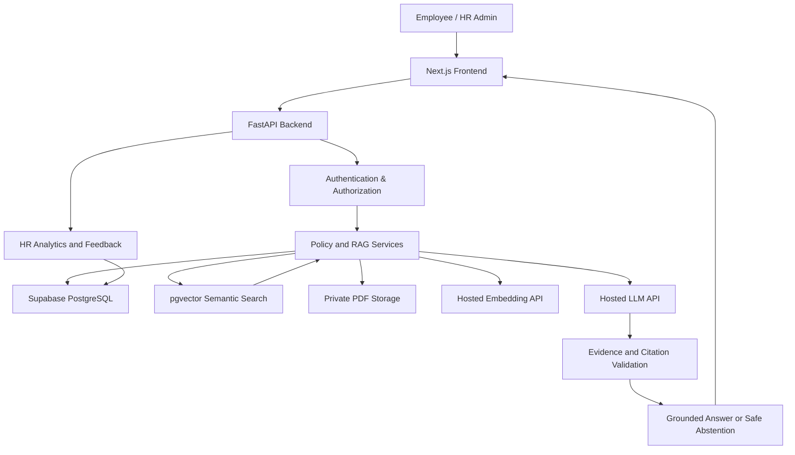
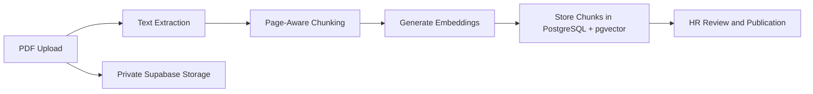
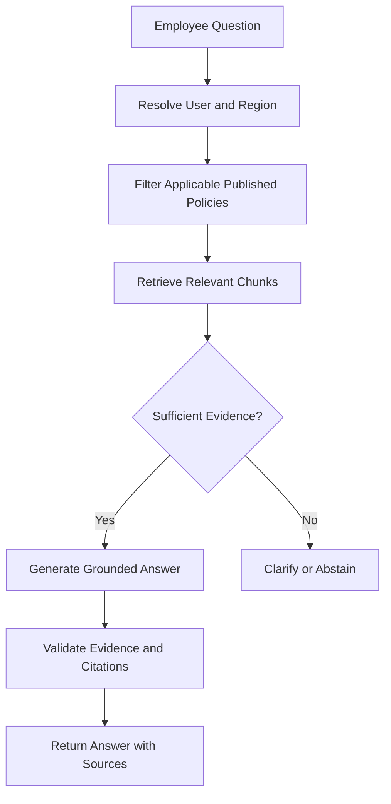

# PolicyPilot AI
### AI-Powered, Region-Aware HR Policy Assistant

PolicyPilot AI is an AI-powered HR policy assistant that helps employees get accurate, context-aware answers to company policy questions without manually searching lengthy documents or repeatedly contacting HR teams.

Unlike generic AI chatbots, PolicyPilot AI retrieves information from approved company policies, considers regional applicability and policy versions, and provides verifiable citations for its answers. When reliable evidence is unavailable, it asks for clarification or safely abstains instead of inventing information.

## 🎯 Problem Statement

Employees often struggle to find relevant HR policies regarding leave, benefits, remote work, and other workplace guidelines. HR teams spend valuable time answering repetitive questions, while generic AI tools may provide unsupported or outdated information.

## 💡 Our Solution

PeoplePolicy AI combines **Retrieval-Augmented Generation (RAG)** with controlled policy management to deliver trustworthy HR information.

### Key Features

- **AI-Powered HR Chat:** Ask policy questions in natural language.
- **Region-Aware Retrieval:** Retrieve policies applicable to the employee's authorized region.
- **Verifiable Citations:** Display source policy, version, and page references.
- **Policy Management:** Upload, review, publish, version, replace, and archive PDF policies.
- **Safe AI Responses:** Clarify ambiguous questions and abstain when evidence is insufficient.
- **HR Analytics Dashboard:** Track question trends, feedback, resolution outcomes, and policy knowledge gaps.
- **Evaluation & Feedback:** Assess retrieval quality, citation correctness, and answer reliability.

## 🏗️ System Architecture

## 🔄 Technical Workflow

### 1. Policy Ingestion

Only processed, reviewed, and explicitly published policies become eligible for employee-facing answers.

### 2. AI Question Answering

## 🛠️ Technology Stack

| Layer | Technology |
|---|---|
| Frontend | Next.js, TypeScript |
| UI Styling | Tailwind CSS |
| Backend | Python, FastAPI |
| Database | Supabase PostgreSQL |
| Vector Search | pgvector |
| Document Storage | Supabase Private Storage |
| PDF Processing | PyMuPDF |
| AI & Embeddings | Hosted LLM and embedding APIs |
| Testing | Pytest |

## 🌟 What Makes PeoplePolicy AI Different?

- **Evidence-first answers:** Responses are grounded in retrieved policy passages rather than general model knowledge.
- **Regional and version awareness:** Answers respect policy applicability and publication status.
- **Traceable information:** Citations link answers to specific policy versions and pages.
- **Responsible AI behavior:** Insufficient or conflicting evidence triggers clarification or abstention.
- **Actionable HR insights:** Analytics help identify recurring questions and potential gaps in policy documentation.

## 🔐 Security and Reliability

PeoplePolicy AI is designed around role-based access, private document storage, server-side authorization, and controlled policy retrieval. Employee queries must never expose policies outside the user's authorized scope. AI-generated answers are informational and do not replace official HR decisions.

## 🚀 Project Roadmap

1. Establish the frontend, backend, authentication, and database.
2. Implement secure PDF ingestion and policy version management.
3. Build region-aware RAG with citations and safe abstention.
4. Integrate the employee chat and HR management interfaces.
5. Add analytics, automated evaluation, security tests, and deployment.

## 🎯 Project Goal

To make company HR policies **accessible, understandable, traceable, and reliable** through an AI assistant that helps employees find the right information while enabling HR teams to manage policy knowledge more effectively.

## 💻 Developer Setup

Refer to [DEVELOPMENT.md](DEVELOPMENT.md) for local environment setup, commands, and testing workflows.

---

**PolicyPilot AI — Trusted Answers. Clear Policies. Better Employee Experiences.**